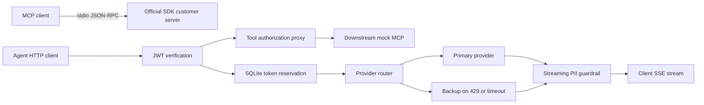

# QuilrAI — MCP & LLM Gateway Assessment

Runnable Python solutions for all four assessment tasks. Includes an official-SDK MCP server, an authenticated JSON-RPC proxy, a streaming PII guardrail, and a resilient model router with an **on-disk SQLite** token budget. All examples use fictional data. The refund tool simulates a refund; it does not move money.

## Quick start

Requirements: Python 3.11+ and [uv](https://docs.astral.sh/uv/getting-started/installation/). The repository defaults to Python 3.12; `uv` can install it if needed.

```bash
uv sync --locked
uv run pytest -q
uv run python scripts/demo.py
```

The demo needs **no API keys or `.env`**. It starts two local HTTP processes on free ports, uses a temporary SQLite file and a randomly generated JWT signing secret, exercises all four tasks, and shuts everything down. It also uses the official MCP client to connect to the stdio server. Expected output includes:

```text
PASS Task 1: official MCP client -> stdio server
PASS Task 2: viewer blocked, admin forwarded
PASS Task 3: Hello! Email [REDACTED], SSN [REDACTED], card [REDACTED]. Goodbye.
PASS Task 4: [primary-429] -> secondary provider
PASS Task 4: [primary-timeout] -> secondary provider
All four tasks demonstrated successfully.
```

The demo prints measured time to the first safe text delta and total stream time. These are local mock measurements, not provider benchmarks.

## Repository map

| Task | Implementation | Verification |
| --- | --- | --- |
| 1. Strict MCP server | `mcp_server.py`, `stdio_validation.py` | Official SDK client; raw subprocess stdout; invalid schemas and JSON-RPC |
| 2. Security proxy | `rpc_proxy.py`, `auth.py` | Role checks, signed/expired tokens, malformed requests, zero forwarding on denial |
| 3. Streaming guardrail | `redaction.py`, `providers.py`, `app.py` | Every two-chunk split for sample PII; randomized chunks; byte-level SSE framing; interrupted streams |
| 4. Budget and fallback | `limiter.py`, `providers.py` | Concurrent independent limiter instances, restart persistence, window boundaries, 429/timeout fallback |

Implementations live in `src/quilr_gateway/`; tests live in `tests/`.



## Task 1 — stdio MCP server

```bash
uv run quilr-mcp
```

This process expects an MCP client on stdin; it is not an interactive command prompt. An example MCP client configuration, with an absolute path to this checkout:

```json
{
  "mcpServers": {
    "customer-records": {
      "command": "uv",
      "args": ["--directory", "/absolute/path/to/repository", "run", "quilr-mcp"]
    }
  }
}
```

Tools:

- `get_customer_record`: `{"customer_id":"CUST-00001"}`
- `trigger_refund`: `{"customer_id":"CUST-00001","amount":12.5,"reason":"Duplicate payment"}`

`CUST-XXXXX` is interpreted as five **ASCII digits**. Pydantic uses strict types and forbids unknown fields. Amounts must be finite positive JSON numbers; numeric strings, booleans, NaN, and infinity are rejected. Whole-valued JSON numbers such as `12` are accepted as amounts. Reasons require at least ten characters after trimming padding. `CUST-00001` is the one seeded fictional customer; other valid IDs return a tool execution error.

The official SDK owns the transport, initialization handshake, request dispatch, and cancellation. A wire preflight adapter returns `-32700` for malformed JSON and `-32600` for malformed envelopes. Unknown methods return `-32601`; malformed tool inputs/unknown tools return `-32602`; unexpected tool failures return sanitized `-32603`. Missing customers return `isError: true`, since that is a business execution failure.

**SDK choice:** `mcp==1.26.0` is pinned. Its `@call_tool` decorator converts validation exceptions to tool error results. A low-level request handler preserves the protocol errors explicitly required by this assessment. All server logs go to stderr; stdout contains only JSON-RPC. The token-generation CLI is a separate executable and intentionally prints its result.

## Run the HTTP services manually

Create the local configuration and replace its placeholder secret:

```bash
cp .env.example .env
uv run python -c 'import secrets; print(secrets.token_urlsafe(48))'
# Paste the generated value into JWT_SECRET in .env.
```

Start these commands in two terminals from the repository directory:

```bash
# Terminal 1: mock MCP and LLM providers
uv run uvicorn quilr_gateway.mock_upstream:app --host 127.0.0.1 --port 8001

# Terminal 2: authenticated gateway
uv run uvicorn quilr_gateway.app:create_app --factory --host 127.0.0.1 --port 8000
```

Generate one-hour demonstration bearer tokens in a third terminal:

```bash
export VIEWER_TOKEN="$(uv run quilr-token --role viewer --tenant tenant-a)"
export ADMIN_TOKEN="$(uv run quilr-token --role admin --tenant tenant-a)"
```

API documentation: <http://127.0.0.1:8000/docs>. Health endpoint: `GET /health`.

## Task 2 — authenticated MCP proxy

JWTs must have a valid HS256 signature, issuer, audience, expiry, subject, and `admin` or `viewer` role. The signed subject is the stable tenant/API-key identity for quotas. Token rotation with the same subject does not reset the quota. Changing the role claim without re-signing invalidates the token.

`tools/list` is forwarded unchanged, including any listed admin tools, as required by the assessment. Authorization is enforced at execution time, not by hiding discovery results. An unauthorized `admin_` invocation returns **`-32001: Unauthorized Tool Call`** with the original request ID and makes no downstream request.

```bash
curl -s http://127.0.0.1:8000/mcp \
  -H "Authorization: Bearer $VIEWER_TOKEN" -H 'Content-Type: application/json' \
  -d '{"jsonrpc":"2.0","id":1,"method":"tools/list"}'

curl -s http://127.0.0.1:8000/mcp \
  -H "Authorization: Bearer $VIEWER_TOKEN" -H 'Content-Type: application/json' \
  -d '{"jsonrpc":"2.0","id":2,"method":"tools/call","params":{"name":"admin_reset_key"}}'
# {"jsonrpc":"2.0","id":2,"error":{"code":-32001,"message":"Unauthorized Tool Call"}}
```

Repeat the second command with `$ADMIN_TOKEN` to allow the call. Invalid or missing authentication returns HTTP 401. Authorized protocol errors use JSON-RPC error objects. Upstream transport failures are sanitized. Client credentials are not forwarded to the downstream server.

This is the requested **POST HTTP/JSON-RPC proxy to a mock**, not a complete Streamable HTTP MCP gateway: no GET event channel, SSE relay, session-ID management, or batch requests. Tool calls without an ID are not executed. Unknown valid notifications receive no JSON-RPC response.

## Task 3 — real-time PII redaction

```bash
curl -N http://127.0.0.1:8000/v1/chat/completions/stream \
  -H "Authorization: Bearer $VIEWER_TOKEN" -H 'Content-Type: application/json' \
  -d '{"messages":[{"role":"user","content":"Hello"}],"max_tokens":256}'
```

The gateway consumes provider SSE, extracts text deltas, and emits its own small SSE contract:

```text
data: {"delta": "Hello! "}

data: {"delta": "[REDACTED]"}

data: [DONE]
```

The guardrail recognizes ASCII email addresses, `DDD-DD-DDDD` SSNs, and 13–19 digit card-like sequences with optional single spaces/hyphens. Card detection is deliberately conservative and does not require a Luhn checksum. This may redact other long numbers.

**Why retain a partial word?** Emitting `alice` immediately would leak the local part if a later chunk completed `alice@example.com`. The scanner holds one unfinished candidate, including numeric runs that could become spaced card numbers. Safe completed text is emitted immediately. State is bounded to 320 characters; oversized candidates produce one `[REDACTED]` marker and are discarded through a boundary. This can over-redact very long benign words. It never accumulates the whole completion.

SSE parsing handles arbitrary UTF-8/network boundaries, CRLF, comments, and multiline data fields. Frames are capped at 64 KiB. Client backpressure is preserved through async iteration; disconnects close the upstream response. Interrupted streams discard the unresolved candidate rather than flushing it. Once response headers are sent, errors use `event: error` with a sanitized gateway error payload; failed streams do not emit `[DONE]`.

Scope: one text choice, no tool-call/reasoning/multimodal payload passthrough. This is a pattern guardrail, not a general PII classifier. Obfuscated addresses, internationalized email syntax, or numbers split by unsupported separators require additional detectors. The nonstreaming endpoint in Task 4 is a routing demonstration and does not apply Task 3 redaction.

## Task 4 — SQLite token budget and fallback

```bash
curl -s http://127.0.0.1:8000/v1/chat/completions \
  -H "Authorization: Bearer $VIEWER_TOKEN" -H 'Content-Type: application/json' \
  -d '{"messages":[{"role":"user","content":"[primary-429]"}],"max_tokens":256}'
# Response model: mock-secondary
```

Use `[primary-timeout]` to demonstrate the 3000 ms primary deadline, or `[all-429]` to demonstrate sanitized provider exhaustion. These triggers exist only in the mock.

- The default budget is **50,000 tokens per rolling 60 seconds per signed tenant identity**.
- Before upstream work, reserve a conservative prompt budget (UTF-8 byte count plus chat-framing allowance) plus `max_tokens`. A provider's successful `usage.total_tokens` replaces that reservation. This avoids pretending a character heuristic is an exact tokenizer. The mock uses an explicitly simple character tokenizer.
- SQLite `BEGIN IMMEDIATE` serializes admission checks and reservations across processes. WAL mode and a busy timeout support concurrent workers without blocking Python's event loop. Persistence survives process restarts.
- Settled usage expires exactly 60 seconds after completion. Active reservations stay counted across the window boundary. A 120-second lease recovers reservations from crashed workers; live streams have a 60-second total deadline. If usage is absent or a request fails/disconnects, retain the entire reservation conservatively. Successful completion-time charging is intentionally stricter than admission-time eviction for long requests.
- Local quota exhaustion returns HTTP 429 with `Retry-After`. It does not contact either provider. Tenant budgets are independent.
- Primary HTTP 429 or a 3000 ms absolute timeout triggers one backup attempt. The nonstreaming deadline includes response headers and body. Other upstream errors are sanitized without automatic retry. Backup timeouts return HTTP 504; exhausted provider rate limits return HTTP 503.
- Streaming can fail over before its first parsed upstream event. Once output has started, it does not switch providers and risk duplicate/inconsistent text. Each stream has a total deadline; HTTPX also enforces an idle read timeout.

The budget counts logical completion usage, not aggregate provider billing across ambiguous timed-out attempts. Byte reservations assume a byte-level tokenizer and the supported simple text-message contract; unusual provider tokenizers/chat templates need an adapter. Usage that exceeds a reservation is still charged in full and can block subsequent requests. Providers must honor `max_tokens` for the reservation to serve as an output bound.

Standard error example:

```json
{"error":{"code":"providers_unavailable","message":"Providers are unavailable","request_id":"..."}}
```

No raw upstream error bodies or stack traces are returned. `.env` and SQLite runtime files are gitignored.

## Real providers and deployment notes

Set `PRIMARY_URL` and `SECONDARY_URL` to full chat-completion URLs, model names in `PRIMARY_MODEL`/`SECONDARY_MODEL`, and their credentials in the corresponding API-key settings. The adapter expects `messages`, `max_tokens`, a text completion, and for streaming, chat-completion SSE deltas ending with `[DONE]`. Providers with different contracts need an adapter. Only the mocks are required for the assessment; live provider integration requires credentials and has not been exercised here.

Keep the mock bound to localhost. For a deployment, the gateway should be the only client-reachable service, with TLS termination and private/allowlisted upstream connectivity. Use workload credentials or mTLS for the downstream hop, and replace the demonstration JWT issuer with the organization's identity system. The gateway uses configured upstream URLs, disables redirects and environment proxy inheritance, and verifies HTTPS certificates by default. Mount the SQLite directory on persistent local storage; SQLite WAL is not appropriate for a multi-host shared network filesystem. Horizontal multi-host deployment would need a shared transactional quota service.

For connectivity troubleshooting, check client-to-gateway auth separately from gateway-to-provider DNS, TLS trust, egress policy, and timeout behavior. Do not disable certificate verification to work around a zero-trust deployment issue.

## Verification and publication

```bash
uv run ruff check .
uv run ruff format --check .
uv run pytest -q
uv run python scripts/demo.py
```

GitHub Actions runs these checks on Python 3.11, 3.12, and 3.13. Tests use isolated SQLite files, deterministic mock transports, and subprocess protocol checks. The demo additionally verifies real HTTP streaming and the production 3-second timeout.

Before submitting, run the commands above, review the design tradeoffs, and publish the source, tests, README, `.env.example`, and `uv.lock` to your public GitHub repository. Keep `.env`, virtual environments, and generated databases private. No paid credentials are required to review this solution.

### References

- [Official MCP Python SDK, pinned release](https://github.com/modelcontextprotocol/python-sdk/tree/v1.26.0)
- [MCP tools specification](https://modelcontextprotocol.io/specification/2025-11-25/server/tools)
- [JSON-RPC 2.0 error conventions](https://www.jsonrpc.org/specification#error_object)
- [Pydantic strict mode](https://docs.pydantic.dev/latest/concepts/strict_mode/)
- [HTTPX async streaming and cleanup](https://www.python-httpx.org/async/)
- [SQLite transactions](https://www.sqlite.org/lang_transaction.html)
